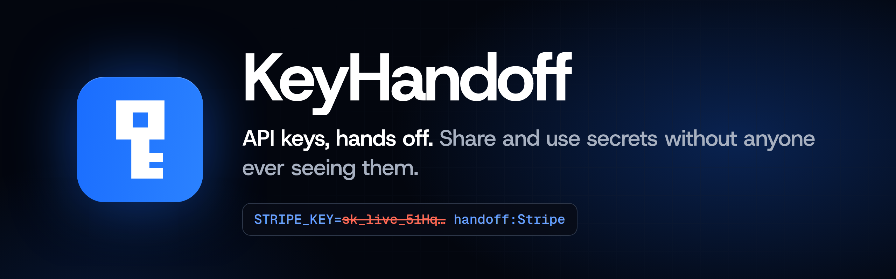
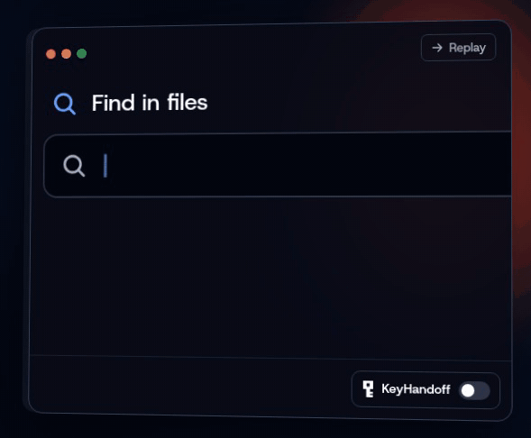
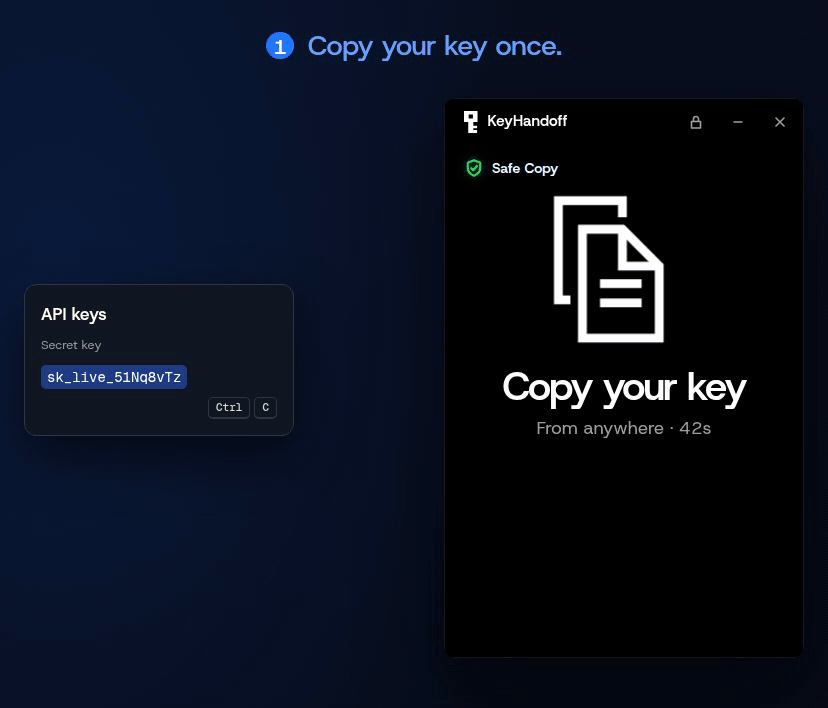
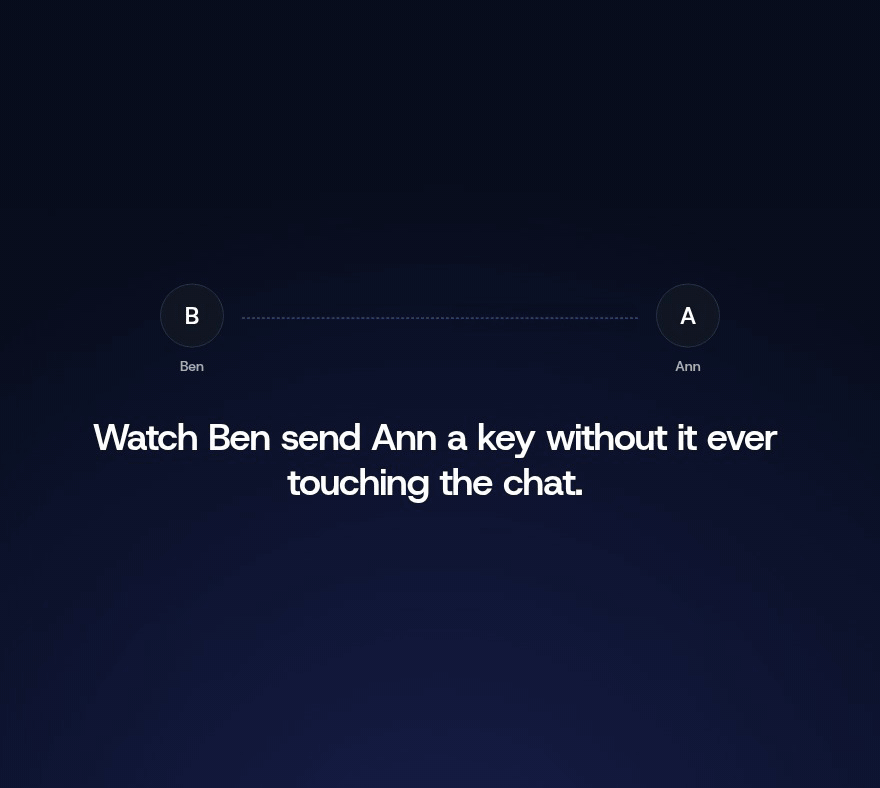
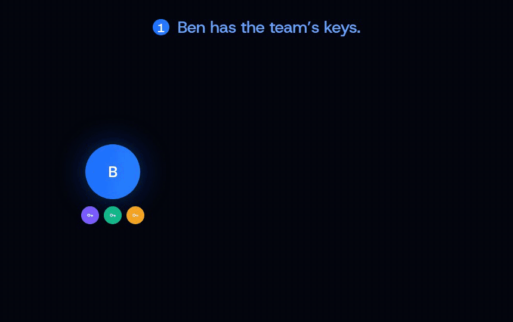

<p align="center">
  <a href="https://keyhandoff.dev"></a>
</p>

<p align="center">
  <a href="https://github.com/junovhs/keyhandoff/releases/latest"></a>
  <a href="https://github.com/junovhs/keyhandoff/actions/workflows/check.yml"></a>
  
  
  <a href="LICENSE.md"></a>
</p>

<p align="center">
  
  
  
</p>

<p align="center">
  <a href="https://keyhandoff.dev/#download"><b>Download</b></a> &nbsp;·&nbsp;
  <a href="https://keyhandoff.dev">Website</a> &nbsp;·&nbsp;
  <a href="https://keyhandoff.dev/docs/">Docs</a> &nbsp;·&nbsp;
  <a href="docs/threats.md">Threat model</a> &nbsp;·&nbsp;
  <a href="paper/paper.pdf">Paper</a>
</p>

<br>

<p align="center">
  
</p>

KeyHandoff is a small desktop app for handing someone an API key, or any other secret, without pasting it into a chat or leaving it in a plain file. There are no servers and no accounts. Cards and keys travel as ordinary files over whatever channel you already use.

Encrypting a key at rest is the easy part. The real exposure comes from people handling it: looking at it, copying it, pasting it into a chat, saving it in a `.env` file. KeyHandoff keeps custody of the key from the provider's page onward, so people and their tools handle it as little as possible.

> [!NOTE]
> **Every claim is tested.** [What KeyHandoff protects, and what it doesn't](docs/threats.md) links each guarantee to the test that checks it, and lists every attack we tried against it.

<br>

## Keep a key



Click **Add a key**, copy the key on the provider's page and name it. **Safe Copy** catches that one copy, wipes the clipboard, and seals the key in your vault. No files are involved, and KeyHandoff has no way to show a key on screen.

<details>
<summary><b>How Safe Copy works</b></summary>
<br>

Safe Copy reads the clipboard only after you ask it to. It catches one copy, then switches off, or stops after 60 seconds. Nothing watches the clipboard the rest of the time. After a catch it wipes the clipboard, and removes the copy from clipboard history where the system allows it.

While it listens on Linux, KeyHandoff also puts harmless bait on the clipboard. If another program reads it before you copy, Safe Copy warns you then, while you can still close it. (Windows will follow.)

When it turns on, it checks the running programs against a short list of known clipboard managers, such as Ditto or CopyQ, and names any it finds, since they can read the key as you copy it. Clipboard extensions built into a desktop shell don't show up as programs, so an empty list isn't a promise.

</details>

<details>
<summary><b>Keep times</b></summary>
<br>

When you accept or add a key you keep it **Once**, for **30 days**, or until you remove it. Your last choice becomes the default. A key kept Once is destroyed after a program first uses it.

</details>

<br>

## Send a key



1. **Pick a teammate.** Ben clicks **Send a key** and picks Ann from his list.
2. **Pick the key.** Ben picks one of his saved keys. KeyHandoff seals it so only Ann's computer can open it, once, and Ben sends her the file. Nothing is copied from anywhere, and the sealed file is deleted once he closes it.
3. **Keep.** Ann opens the file. The key goes into her vault, and every copy of the sealed file, in the chat or anywhere else, can never be opened again.

<details>
<summary><b>What you handle</b></summary>
<br>

| Thing | What it is | Secret inside? |
|---|---|---|
| **Card** (`KeyHandoff card - Ann.handoff`) | Ann's public identity and 12 one-time locks. Whoever has it can send Ann up to 12 keys. | No |
| **Sealed key file** (`Key for Ann.handoff`) | The key, locked so only Ann's computer can open it, and only once. | Yes, encrypted |
| **Team key file** (`Key for Platform.handoff`) | One key, sealed separately for each member of a team. Each member opens their own copy, once. | Yes, encrypted |
| **Kept key** | An entry in your vault: its name and source, never its value. | Stored encrypted |

Both files hold damage-resistant text, so they can also be pasted as text when a channel can't carry files.

</details>

<details>
<summary><b>Adding a teammate, teams, nearby and team folders</b></summary>
<br>

To be on Ben's list, Ann sends him her card once: she clicks **Your card** and sends the file in an email or chat. Ben opens it, and Ann becomes a contact, with her computer's fingerprint to check with her if it matters. Each card copy is for one person and carries fresh locks. To drop someone, click the cross on their row in **Send a key**: they come off your teams too, and keys you already sent stay with them.

Ben can keep sending Ann keys until her card's locks run out; then he asks for a new card.

**Teams.** In **Send a key**, **New team** groups some of your contacts under a name. Sending a saved key to a team seals it to every member in one file, and files your key under the team. **Welcome** on a member sends them every key you hold that was shared with the team, so someone new gets them all. There's no server, so a team lives on each person's computer: anyone can set up the same team to share with it, and everyone on it needs to have sent you their card.

**Nearby.** On the same network, **Find people on this network** in Send a key lets contacts' KeyHandoffs see each other, and a sealed key can go straight to their computer instead of through a chat. It's off unless you turn it on, stops when KeyHandoff locks, and only takes keys from people on your list. In the same room, **Add someone nearby** swaps cards over the network: both screens show a six-digit code, and you confirm it matches.

**Team folders.** A team can also live in a folder everyone already syncs: Dropbox, Google Drive, OneDrive, a repo or a network share. **New team → Keep it in a shared folder** puts an invite there; people open it and click **Join**, and you **Add** them. Keys you share with the team reach everyone through the folder, and **Replace** on a key you rotated gives everyone the new value under the same name, so their `.env` pointers and programs keep working. KeyHandoff only reads and writes the folder; everything in it is sealed.

To keep a key of your own, click **Add a key**, copy the key on the provider's page and name it. No files are involved. KeyHandoff has no way to show a key on screen.

</details>

<br>

## Work as a team



Group contacts into a team and one send reaches everyone. Put the team in a folder you already sync, and a key you rotate reaches everyone under the same name, so their `.env` pointers and programs keep working. When someone leaves, take them off the team and **Replace** the key once: everyone still on it gets the new value.

<br>

## Use a key in your code

Your `.env` holds a pointer instead of the key:

```diff
- STRIPE_SECRET_KEY=sk_live_51Hq8vTz...
+ STRIPE_SECRET_KEY=handoff:Stripe
```

Then either load it with a one-line loader, or start any program, in any language, with no code change:

```bash
keyhandoff run -- python report.py
```

On Linux the program only ever holds a look-alike key. KeyHandoff swaps the real one in only inside an encrypted connection to the key's own server, after checking that server's certificate itself. A look-alike headed anywhere else is a tripwire: it's stopped before it leaves, and you're told which command tried to send it, and where.

On Windows the installer puts the `keyhandoff` command on your PATH, so this works in any new terminal (cmd, PowerShell, Git Bash). There the program gets the real key in its environment for now, with every printed form of it hidden; look-alikes on Windows wait for the schannel hook.

<details>
<summary><b>The full walkthrough</b></summary>
<br>

1. **Point at the key.** Your `.env` holds `DIALPAD_API_KEY=handoff:Dialpad` instead of the key. **Copy .env line** on the key's row gives you that line, with a variable name made from the key's name; rename the variable if your code expects another. The name after `handoff:` matches a kept key, ignoring case. Names are unique, so a pointer always means one key.
2. **Load it.** Copy a one-line loader next to your script: [`keyhandoff_env.py`](loaders/keyhandoff_env.py) for Python (`keyhandoff_env.load()`) or [`keyhandoff_env.mjs`](loaders/keyhandoff_env.mjs) for Node.js (`await load()`). Call it once at startup, after any `.env` loader you already use, such as `load_dotenv()` or `dotenv`. Your code then reads `os.environ` or `process.env` as before. It asks the running app for every pointed-to key at once, over a local socket (a named pipe on Windows). The loader runs inside your program and sets the variable there, rather than launching the program with the key, because a program's starting environment can be read by other programs running as you.
   Or, for any language and no code change, start the program with **`keyhandoff run -- python report.py`**: it fills the pointers in `.env` and the environment and starts the command with the keys. On Linux, a key whose server is known (**Only for api.stripe.com** on its row) reaches the program as a stand-in with the same prefix and length, and KeyHandoff swaps the real key in only inside a TLS connection whose certificate it has checked for that server. The environment, logs and anything a package uploads hold only the stand-in. A stand-in headed anywhere else is stopped before it leaves; KeyHandoff names the command and the destination, refuses that destination from then on, and warns your team folders. Each run gets its own stand-ins, so one found later traces back to its run. This covers programs using the system's OpenSSL (Python, Ruby, PHP, curl) and Node.js; see [threats.md](docs/threats.md#placeholders-under-keyhandoff-run) for the rest.
3. **Allow it.** KeyHandoff asks the operating system which program is asking and which folder it runs in. The first time, the window shows the command and the folder, and you choose **Always allow**, **Just this once** or **Deny**. Always allow covers that exact command (the program, its arguments and the files they name), in that folder, for those keys; an edited script or a one-off `python -c` asks again. When an AI coding agent such as Claude Code or Cursor started the command, KeyHandoff always asks, names the agent, and offers **Allow for 30 minutes** instead of Always.
4. **Use it.** The value goes into the program's own environment. Nothing is written to disk. A key the program prints shows as `[KeyHandoff: Dialpad hidden]`, plain, base64, hex, URL-encoded or backwards.

Typing a key into a field, without the clipboard, is still being built.

</details>

<br>

## How well it holds up

Everything below is measured and rerunnable with [`eval/run.sh`](eval/run.sh), and the coverage matrix and attack replays run in CI on every push.

- **Real attacks, replayed.** Reconstructions of the Nx "s1ngularity" and Shai-Hulud stealers, a `.env` hunter and AI-agent leaks all ended the same way: the attacking code only ever held a placeholder, no real key left the machine, and every send was stopped and traced to its command. [Results](eval/results/replays.md)
- **Wide coverage.** 12 of 15 client and protocol combinations are protected, including HTTP/2 and Node.js. In the other three the key never leaves; the request just fails. [Matrix](eval/results/coverage.md)
- **Barely noticeable.** About 0.26 ms extra on a request where the key is swapped in, 2 µs on any other, and uploads run within noise. [Benchmarks](eval/results/benchmarks.md)
- **Attacked on purpose.** 21 attacks on placeholders, each with its outcome and evidence. [Threat model](docs/threats.md#attacks-on-placeholders)

<details>
<summary><b>What it protects, and what it doesn't</b></summary>
<br>

Chat and email only ever carry a sealed file. Sending leaves nothing new on the sender's computer, a sealed file opens once, keys are encrypted on disk and never shown, and there are no servers, accounts or telemetry. The only network request is the check for a signed update.

It can't stop a program that's watching the clipboard from reading a key at the moment you copy it, or stop anything running as you from reaching the vault while it is unlocked. While it is locked, only your passphrase or recovery code opens it. A program you allow can do anything with the key it gets. **[docs/threats.md](docs/threats.md)** has the full list, with the test or design rule behind each claim.

The sender can't control what the receiver does with a key afterwards, and KeyHandoff doesn't pretend otherwise. It isn't trying to be a general password manager, a phone app or a service with accounts.

</details>

<details>
<summary><b>Locking</b></summary>
<br>

KeyHandoff starts locked. The first time, you choose a passphrase, or take five suggested words, and write down the recovery code it shows once. After that, the passphrase opens it.

It locks again when the computer sleeps, when the screen locks, and from the lock button in the title bar. To also lock after a quiet spell, pick **Lock after** (15 minutes or 1 hour) under Security. A program that asks for a key while it's locked brings the window forward and waits up to two minutes for you.

**Security**, at the bottom of the home screen, has two options:

- **PIN instead of the passphrase**, where the computer has a TPM KeyHandoff can use. The key is sealed inside the TPM, which checks the PIN and stops anyone guessing it, so the PIN can be short. On Linux the TPM belongs to the `tss` group: run `sudo usermod -aG tss $USER` and sign in again. A TPM that's switched off in the firmware settings shows as none. Windows uses Windows Hello instead (coming).
- **Remember on this computer**, which opens KeyHandoff without asking and keeps it open through sleep and screen lock. It's off unless you turn it on: any program running as you could then open your keys.

The passphrase and recovery code always work. If you lose both, the keys can't be opened by anyone, you included.

</details>

<br>

## Install

Download it from **[keyhandoff.dev](https://keyhandoff.dev/#download)** or [GitHub releases](https://github.com/junovhs/keyhandoff/releases): a Windows installer, or a `.deb` or AppImage for Linux (X11). Installed copies check GitHub for a signed update at launch and every six hours. While KeyHandoff is locked, a Windows or AppImage update installs and restarts on its own; otherwise **Restart to update** shows in the title bar. A `.deb` update always waits for that click, because installing it asks for your password.

Windows and Linux (X11). macOS and Wayland aren't supported.

<br>

## For developers

<details>
<summary><b>Build</b></summary>
<br>

You need [Rust](https://rustup.rs) and [Node.js](https://nodejs.org), plus the [Tauri prerequisites](https://tauri.app/start/prerequisites/) for your system.

```
npm install
npm run tauri dev                   # run with hot reload
npm run tauri build                 # installer in src-tauri/target/release/bundle
npm run tauri build -- --no-bundle  # just the binary
```

To try two identities on one computer, run each with its own profile: `keyhandoff --profile second`, or set `KEYHANDOFF_PROFILE=second`.

</details>

<details>
<summary><b>Tests</b></summary>
<br>

```
cd crates/seal && cargo test
cd src-tauri && cargo test
cd src-tauri && cargo test -- --ignored --test-threads=1   # real clipboard checks
```

Tests only ever use synthetic keys. On Linux the real clipboard checks need `DISPLAY` and `xclip`.

</details>

<details>
<summary><b>Release</b></summary>
<br>

Set `version` in `src-tauri/Cargo.toml` and add a `## [x.y.z]` section to [CHANGELOG.md](CHANGELOG.md). Once both are on `main`, [the release workflow](.github/workflows/release.yml) builds and signs the Windows installer, `.deb` and AppImage, publishes them on GitHub with `SHA256SUMS` and the updater's `latest.json`, and rebuilds keyhandoff.dev so its download links follow. It needs these repository secrets: `TAURI_SIGNING_PRIVATE_KEY` and `TAURI_SIGNING_PRIVATE_KEY_PASSWORD` (the updater key; keep an offline copy, because without it installed copies can't be updated) and `CLOUDFLARE_SITE_DEPLOY_HOOK`.

</details>

<details>
<summary><b>The README's pictures</b></summary>
<br>

The banner and GIFs come from the website's own animations. Build the site (`npm run build` in `site/`), then run `node scripts/readme-media/record.mjs` from the repo root; it needs `ffmpeg` and Chromium.

</details>

### Documentation

- [Every screen, in flow order](docs/screens.png): regenerate with `node scripts/site-shots/board.mjs`
- [What it protects, and what it doesn't](docs/threats.md)
- [Capture tests: the copy moment](docs/capture-tests.md)
- [Architecture](docs/architecture.md)
- [Sealing format and key storage](docs/sealing-format.md)
- [Design rules](docs/rules/keyhandoff.md)

<br>

## License

KeyHandoff is free and open to read, including for use at work.

- The app is under the [PolyForm Shield License 1.0.0](LICENSE.md), which doesn't allow using it in a product that competes with KeyHandoff. It isn't an OSI-approved open source license.
- The sealing library, [`crates/seal`](crates/seal), is under the [Apache License 2.0](crates/seal/LICENSE), so it can be reviewed and reused freely.

Copyright © 2026 Spencer Nunamaker. Outside contributions aren't being accepted right now.

To report a security problem, see [SECURITY.md](SECURITY.md).

<br>

<p align="center">
  <a href="https://keyhandoff.dev"></a>
  <br>
  <sub>Made by <a href="https://strangesystems.dev">strange systems</a></sub>
</p>
